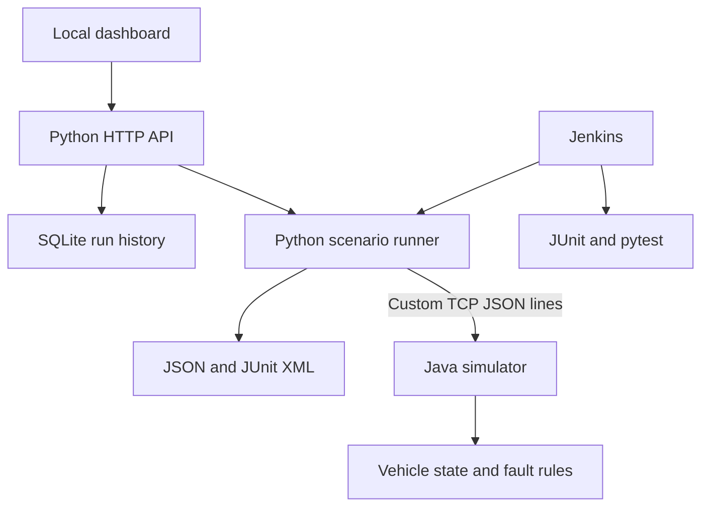

# DriveBench

**A local vehicle-reference workspace and virtual test lab, built with Python and Java.**

Save vehicles in My Garage, enter measurements or import CSV recordings, and inspect source-backed reference comparisons. Every result explains the applicable conditions and source. The Simulation Lab also lets you inject thermal, voltage, and communication faults into a Java simulator, run Python automation, and export JSON and JUnit XML reports.

> v0.2 includes two reviewed Toyota owner-manual profiles for **resting battery voltage only**. Other vehicles and signals show **reference unavailable**. Results are reference comparisons, without an overall vehicle-health verdict. The separate simulation lab uses fictional thresholds and custom loopback TCP/IP; it does not implement CAN, LIN, UDS, DoIP, or live OBD-II connectivity.

## New in v0.2 — My Garage

Start the vehicle-reference workspace with **Python 3.11+ only**:

```powershell
python start.py --garage-only
```

Open [http://127.0.0.1:8088](http://127.0.0.1:8088). Choose a reviewed profile or save a custom vehicle by brand, year, model, engine, powertrain, and market. Enter manual readings or import a CSV, then expand a result to see its rule, measurement conditions, and manufacturer source. Export a session as JSON or a readable text report.

| Capability | Behavior |
| --- | --- |
| Reviewed profiles | US-market 2016 Toyota Corolla (1.8 L 2ZR-FE / 2ZR-FAE) and 2017 Corolla iM (1.8 L 2ZR-FAE) |
| Battery reference | Discrete full-charge, half-charge, and discharged voltage bands from each vehicle's Toyota owner manual |
| Conditions | At 20 °C, measured 20 minutes after engine and all lights switch-off; a battery-terminal voltmeter reading is required |
| Coverage gaps | No charging-voltage, coolant, RPM, speed, or other-vehicle limits are inferred |
| Input | Manual values or strict UTF-8 CSV; voltage, coolant temperature, RPM, and speed; explicit missing readings |
| Units | V, C/F, rpm, km/h/mph; temperature and speed are normalized before reporting |
| Persistence | Up to 100 vehicles; latest 100 assessment reports, separately from simulator test history |

The default form conditions are **not recorded**. They must be supplied before a resting-battery reference can apply. Values between the documented bands remain unclassified; the application does not estimate a charge percentage or diagnose a component. A custom vehicle can record measurements, but cannot inherit another vehicle's limits by name similarity.

Use [the CSV example](examples/resting-battery.csv) to explore the interface. **Its readings are fictional examples, not measurements from your vehicle.** Replace them with your own readings. CSV imports validate every row before saving anything; timestamps require `Z` or an explicit UTC offset. A blank value means missing, never zero or healthy.

Reference details, exact source pages, document hashes, and scope are documented in [REFERENCES.md](docs/REFERENCES.md). Reports preserve their vehicle, source, and catalog version so later catalog updates do not rewrite historical interpretations.

## Start the complete garage + simulator on Windows

Requirements: **JDK 17+**, **Maven 3.9+**, and **Python 3.11+** on your PATH. Java 21 works. No Python packages are required to run the dashboard. The first Maven build requires internet access to download dependencies.

Extract the ZIP, open PowerShell inside the `DriveBench` folder, and check:

```powershell
java -version
mvn -version
python --version
```

Build and start:

```powershell
mvn -B -f simulator/pom.xml verify
python start.py --no-build
```

Open **[http://127.0.0.1:8088](http://127.0.0.1:8088)**, select **Simulation Lab**, then **Run full suite**. My Garage remains available in its own workspace. Keep the terminal open. Press **Ctrl+C** to stop both the dashboard and its Java simulator.

You can also double-click `Start-DriveBench.cmd`. It builds Java and starts the dashboard. If Windows uses `py` instead of `python`, run `py start.py --no-build` after building.

On Linux/macOS, use the same Maven command followed by `python3 start.py --no-build`.

## What you can demonstrate

| Area | Concrete implementation |
| --- | --- |
| Java object-oriented design | `Sensor` interface, bounded `AnalogSensor`, synchronized `VehicleState`, protocol dispatcher, TCP server, and session-scoped fault injector |
| Python object-oriented design | Diagnostic client, scenario runner, simulator process manager, run service, SQLite repository |
| Automated testing | JUnit tests of vehicle behavior and TCP framing; pytest tests of real Java/Python integration, malformed responses, deadlines, API boundaries, persistence, and reporting |
| CI automation | Jenkinsfile builds Java, runs JUnit and pytest, executes the vehicle suite, publishes test results, and archives reports |
| Integration and debugging | Real TCP communication between separate processes, request IDs, TX/RX/error traces, explicit timeouts, reconnect checks, persisted run history |
| Networking foundations | TCP byte-stream framing, bounded messages, strict JSON validation, correlation IDs, session failure handling |

This is portfolio evidence of implemented skills. Completing the project does not establish the employer's required two years of work experience or six months of vehicle-network experience. Review, extend, and understand the implementation before presenting it as your work.

## The six scenarios

| Scenario | What passes |
| --- | --- |
| Nominal operation | Ignition, default sensor values, clean diagnostics, and a speed update propagate correctly |
| Thermal fault lifecycle | 110 °C activates a fault; 103 °C retains it; 98 °C recovers; the stored code remains until cleared; clearing an active fault is rejected |
| Battery undervoltage | 10.5 V activates a fault; 11.8 V retains it; 12.6 V recovers; clearing succeeds after recovery |
| Timeout & reconnect | A one-shot 600 ms delay exceeds the client's 150 ms response deadline; a fresh connection reads successfully |
| Connection loss | A deliberate connection drop produces a transport error; reconnection succeeds |
| Input validation | Invalid temperatures and unknown commands are rejected without mutating state or breaking the session |

An expected timeout or disconnect is a **passing assertion** when the client detects it and successfully recovers. Unexpected failures make the scenario and overall suite fail.

## Architecture



The dashboard binds to loopback. A managed Java subprocess also binds to loopback and chooses an available TCP port. Only one dashboard test run can mutate the simulated vehicle at a time. Each scenario resets its baseline; direct external clients can still mutate shared state, so use one test runner per simulator.

The simulator uses four workers and an eight-connection queue. Frames are bounded, idle sessions time out, and every connection has its own one-shot transport fault plan. Telemetry polling uses a separate connection, so it cannot consume the test runner's injected disconnect or delay.

## Run automation without the dashboard

```powershell
python -m drivebench run --no-build
python -m drivebench run --no-build --scenario overheat
```

Each command launches and stops its own Java simulator, prints assertion totals, and writes `reports/scenarios.json` and `reports/scenarios.xml`. A passing run exits `0`; a failed run exits `1`. Later executions replace those report files.

You can run a standalone simulator and connect a runner:

```powershell
java -jar simulator/target/drivebench-simulator.jar --port 7071
# In another terminal, from the DriveBench folder:
python -m drivebench run --sim-port 7071 --scenario baseline
```

`python start.py` can build Java automatically when the JAR is missing or sources are newer. `--no-build` requires an existing JAR. Change the dashboard port with `--port 8090`.

## Run all automated checks

```powershell
mvn -B -f simulator/pom.xml clean verify
python -m venv .venv
.venv\Scripts\python -m pip install -r requirements-dev.txt
.venv\Scripts\python -m pytest --junitxml=reports/pytest.xml
.venv\Scripts\python -m drivebench run --no-build
```

On Linux/macOS, use `python3` to create the environment and `.venv/bin/python` for subsequent Python commands. The integration fixture requires the built JAR and starts a real Java process; missing Java/build artifacts fail the tests rather than silently skipping them. Run the tests sequentially because the session fixture shares vehicle state.

## Jenkins

Create a Jenkins **Pipeline from SCM** job pointing at your repository, with script path `Jenkinsfile`. The agent needs Java 17+, Maven 3.9+, Python 3.11+ (`python3` on Unix, `python` on Windows), network access for dependencies, and the Jenkins Pipeline, JUnit, Git, and Timestamper plugins. Configure private repository credentials in Jenkins if needed.

The pipeline builds the shaded Java JAR, executes JUnit, creates a Python environment, runs pytest against Java, and executes all six vehicle scenarios. It publishes all three sets of JUnit XML and archives JSON/XML artifacts. Scenario failures return a nonzero exit code and fail the build. Concurrent builds are disabled to avoid sharing a workspace.

The repository includes the pipeline definition. An actual Jenkins controller/agent execution must be verified in your own Jenkins installation; local Maven, pytest, and CLI validation do not prove a Jenkins deployment.

## Inspect and debug a failure

1. Select the run in the dashboard and find the first failed assertion.
2. Open **Protocol trace**. Expand the matching TX, RX, or ERROR entry and follow its full `request_id` across the exchange.
3. Check the command, sensor value, fault state, and elapsed response time. A remote validation error keeps the connection usable; a timeout, disconnect, or malformed response closes it.
4. Re-run the individual scenario from the CLI. Export JSON for a complete trace or JUnit XML for CI reporting.

The client never blindly retries a timed-out command. The simulator may have executed a delayed operation even after the client gave up. Recovery scenarios delay read-only commands and establish a new session before continuing.

## Project layout

```text
DriveBench/
  simulator/        Java simulator, JUnit tests, Maven build
  drivebench/      Python client, runner, HTTP service, reports, SQLite store
    web/           Local dashboard HTML, CSS, JavaScript; no CDN
  tests/           pytest unit and real-process integration tests
  docs/            Protocol and HTTP API references
  Jenkinsfile      Build, tests, JUnit publication, artifact archive
  start.py         Dashboard entry point
  Start-DriveBench.cmd
```

All local records are saved under `data/drivebench.db`. Upgrading an existing v0.1 database adds garage tables without replacing simulator runs. The latest 50 completed simulator runs and latest 100 vehicle assessment reports are retained independently. On restart, unfinished simulator runs become `interrupted`. The CLI reports are separate from dashboard history. Export reports before deleting the database. Vehicle identities and saved reports are immutable in v0.2; editing/removal controls are future work.

## Troubleshooting

| Problem | Action |
| --- | --- |
| `java`, `mvn`, or `python` is not recognized | Install the prerequisite, add its executable/bin directory to PATH, and reopen PowerShell |
| `UnsupportedClassVersionError` | Ensure `java -version` is 17 or newer; check Maven's Java version with `mvn -version` |
| Maven cannot download dependencies | Check internet, proxy, and Maven settings; retry the build. Do not disable certificate verification |
| Dashboard port is occupied | Run `python start.py --no-build --port 8090` |
| Python opens the Microsoft Store | Use `py` or install Python and adjust Windows App Execution Aliases/PATH |
| Simulator JAR missing | Run `mvn -f simulator/pom.xml verify` from the project folder |
| Simulator offline | Check the terminal; for a standalone simulator verify the port and that its Java process is running |
| Fault remains stored after sensor recovery | Expected latching behavior. The scenario clears it only after active faults have recovered |

See [the protocol contract](docs/PROTOCOL.md) and [the HTTP API](docs/API.md) for exact request formats and limits.

## Useful next extensions

VIN-assisted vehicle identification, more reviewed vehicle references, recording charts/replay, and live OBD-II adapters are future extensions. NHTSA VIN decoding could help identify vehicles; it would not itself supply diagnostic reference limits. Real CAN/LIN communication and hardware validation remain separate future work.

Add a new sensor and failure rule, parameterize threshold tests, introduce a replayable scenario file format, or add a transport adapter for a virtual CAN bus. A future CAN adapter should use actual CAN tooling and separate protocol-specific tests; the current TCP simulator is not a substitute for that experience.

MIT licensed.
